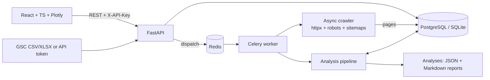
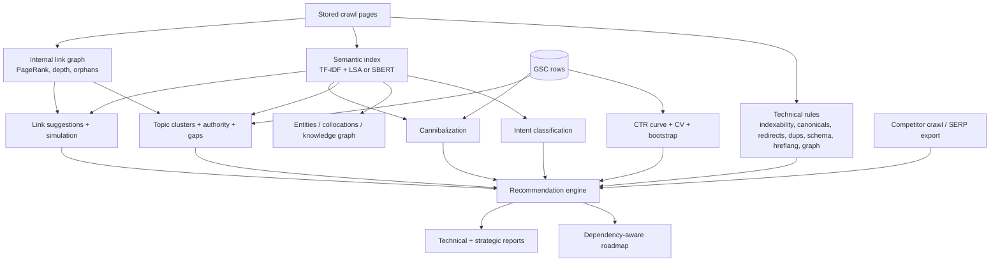

# ASIGE Architecture

## System

Without `REDIS_URL` jobs run in an in-process thread (single-machine / dev mode); `ASIGE_SYNC_JOBS=1` runs them inline (tests).

## Analysis pipeline

## Algorithms (all deterministic given seed 0)

| Module | Algorithm | Key parameters |
|---|---|---|
| Crawler | async BFS priority queue (depth, seq); robots.txt (5xx = disallow); sitemap seeding; manual redirect chains (loop detection); per-host delay + `Crawl-delay`; SSRF guard | `max_pages`, `max_depth`, `delay`, `concurrency` |
| Near-duplicates | 64-bit SimHash on unigrams; pigeonhole LSH banding (`d+1` bands) = exact for Hamming <= d | `d = 3`, bucket cap 300 |
| Embeddings | TF-IDF (1-2 grams, sublinear) -> TruncatedSVD (LSA, 128 d) -> L2; or Sentence-Transformers | `ASIGE_EMBEDDINGS` |
| Clustering | average-linkage cosine agglomerative (<= 3000 items) else MiniBatchKMeans; zero vectors grouped lexically | threshold 0.8 (LSA) / 0.55 (SBERT) |
| Entities | schema.org names + English proper-noun runs + NPMI collocations (works for Persian); **no pretrained NER** | NPMI >= 0.3, count >= 3 |
| Intent | weighted EN/FA lexicon + brand terms; page intent from schema/URL/title | |
| Topical authority | weighted mean of available components: coverage .35, depth .25, cohesion .20, performance .20 | |
| Cannibalization | per query: dispersion = 1 - normalized HHI of page impression shares; score = ln(1+impr) x dispersion x (0.5+0.5 sim) | min share 10% |
| Link suggestions | `sim x (0.5 + 0.5 PR_src/PR_max) x need`; simulation re-runs PageRank with added edges | sim >= 0.35 |
| CTR model | isotonic (monotone) regression of CTR on impression-weighted bin position; k-fold WAPE vs constant and prior baselines; HistGB + permutation importance as explainer | falls back to generic prior if < 200 rows / 5000 impressions |
| Scenarios | extra clicks = sum(impr x (CTR(new) - CTR(old))); 90% interval from bootstrap refits | `n_boot` |
| Prioritization | impact (0-100) x confidence / (hours + 1) | see below |

## Recommendation scoring

* **Impact (0-100)** – technical items: severity base (critical 90, high 70, medium 40, low 15) x (0.6 + 0.4 sqrt(share of indexable pages)). Click-model items: `100 e / (e + median(e))` where `e` is the estimated click gain. The `basis` field states which was used; compare across bases with care.
* **Confidence (0.05-0.95)** – per rule (crawl-observed facts 0.9-0.95; heuristics 0.6-0.8), discounted when the crawl budget was exhausted or the CTR curve is a generic prior. Every reason is listed.
* **Effort (hours)** – `base + per_url x min(affected, 200)` per rule type.
* **Dependencies** – B depends on A when A is a prerequisite layer (rank 0: crawl/index blockers; rank 1: duplicate/cannibalization consolidation) and shares a target URL. Graph is verified acyclic.
* **Provenance** – each recommendation carries `provenance[]`: module, algorithm, data source (crawl / gsc / competitor crawl / user SERP export), metrics, evidence URLs, parameters, engine version. Run-level metadata (input digests, seed, params, reproducibility hash over all outputs) is in `meta`.

## Security & respectful crawling

* robots.txt honored (cannot be disabled through the API); identifying User-Agent; per-host delay (>= 0.05 s via API, honors `Crawl-delay`); page/byte/time budgets.
* SSRF guard: only http(s), private/loopback/link-local/reserved addresses blocked at every redirect hop.
* GSC access tokens are request-scoped: never stored, never logged, never echoed in errors.
* Optional API key (`X-API-Key`, constant-time compare); CORS allow-list.
