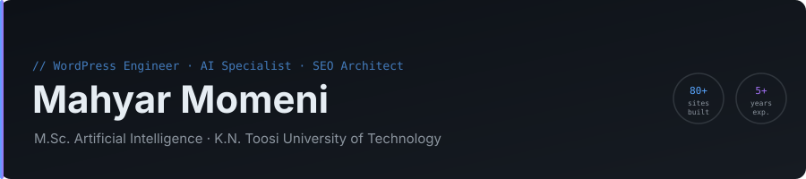
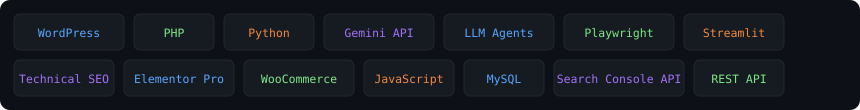

**[وب‌سایت](https://mahyarhub.ir)** · **[لینکدین](https://ir.linkedin.com/in/mahyar-momeni-4a46b2223)** · **[تلگرام](https://t.me/mahyar_mmi)** · **[ایمیل](mailto:mahyarmni@gmail.com)** · **[English](README.md)**

---

## درباره من

توسعه‌دهنده وردپرس و متخصص هوش مصنوعی با بیش از ۵ سال تجربه واقعی در توسعه افزونه، طراحی سایت و اتوماسیون مبتنی بر AI. دانش‌آموخته **کارشناسی ارشد هوش مصنوعی** از [دانشگاه صنعتی خواجه نصیرالدین طوسی](https://kntu.ac.ir).

حوزه کاری در سه محور:

- **افزونه‌های تخصصی وردپرس** — از ابزارهای سئو تا ایجنت‌های یکپارچه با مدل‌های زبانی
- **طراحی و توسعه وب** — بیش از ۸۰ سایت در حوزه‌های حقوقی، فروشگاهی، دانشگاهی و شرکتی
- **اتوماسیون و ابزارسازی AI** — ایجنت‌های Python، خزنده‌ها، ابزارهای سئو و تولید لید، پایپلاین‌های LLM (Gemini، Groq، OpenRouter)

---

## افزونه‌های وردپرس

همه‌ی افزونه‌ها ساخته‌ی **مهیار مومنی** هستند، مستندات فارسی و انگلیسی دارند و سطح ریسک دارند:
🟢 کم · 🟡 متوسط (داده/فایل را تغییر می‌دهد یا از سرویس ثالث استفاده می‌کند) · 🔴 زیاد (در صورت سوءاستفاده می‌تواند به سایت‌ها آسیب بزند یا قوانین را نقض کند — اول هشدار ریسک را بخوان).

| افزونه | نسخه | ریسک | توضیح |
|---|:---:|:-:|---|
| [**Backlink Pilot**](https://github.com/mahyarrmni/backlink-pilot) | 1.10.0 | 🔴 | رایگان. چرخه‌ی بک‌لینک: امتیازدهی دامنه، ایجنت برنامه‌ریز AI، انتشار اتوپایلوت در بیش از ۱۰ پلتفرم (Telegra.ph، DEV.to، Write.as، Hashnode…) با حالت بازبینی و پروفایل محتاط/متعادل/سریع، اتصال Search Console و رادار یادگیرنده‌ی هفتگی. **لینک‌سازی خودکار ریسک موتور جستجو و پلتفرم دارد — هشدار را بخوان.** |
| [**SEO Intelligence**](https://github.com/mahyarrmni/seo-intelligence) | 2.2.0 | 🟢 | خواندن داده‌ی واقعی Google Search Console و نمایش شکاف CTR، گیر کردن در رتبه و فرصت‌های خوشه‌بندی کلمات. فقط‌خواندنی — بدون کلیک و ترافیک جعلی. |
| [**Content Cannibalization Scanner**](https://github.com/mahyarrmni/content-cannibalization-scanner) | 2.2 | 🟡 | تشخیص کانیبالیزیشن و قصد جستجوی تکراری؛ v2.2 گزارش امنیت سایت (امضای بدافزار، CVE افزونه/قالب با WPVulnerability، Safe Browsing، سلامت هسته) با dry-run، بکاپ و بازگردانی. |
| [**404 Radar**](https://github.com/mahyarrmni/404-radar) | 1.1.0 | 🟢 | ثبت ۴۰۴ها، پیشنهاد نزدیک‌ترین صفحه و رفع با ریدایرکت ۳۰۱ یک‌کلیکی؛ قانون‌های اختیاری و ایمیل هفتگی. رابط دوزبانه. |
| [**QA Contact Form**](https://github.com/mahyarrmni/qa-contact-form) | 2.1.0 | 🟢 | فرم تماس با فیلدساز کشیدنی، اعتبارسنج ایرانی (موبایل / کد ملی / کد پستی)، آپلود فایل، پاسخ خودکار، اعلان تلگرام و وب‌هوک، خروجی CSV و ضداسپم چندلایه. |
| [**Phone Number Changer**](https://github.com/mahyarrmni/phone-number-changer) | 1.1 | 🟡 | جایگزینی شماره تماس در کل سایت با همه‌ی قالب‌های رایج ایرانی؛ حالت موقت (فقط HTML) و دائمی (دیتابیس، با dry-run). |
| [**Smart Alt Setter**](https://github.com/mahyarrmni/smart-alt-setter) | 1.1.0 | 🟡 | تنظیم گروهی ALT (به ترتیب) فقط برای تصاویر استفاده‌شده در نوشته‌ها و برگه‌های منتشرشده. |
| [**Bulk Image Alt**](https://github.com/mahyarrmni/bulk-image-alt) | 1.3.0 | 🟡 | تنظیم ALT (به ترتیب) برای تصاویر بدون ALT کتابخانه، با گزارش ممیزی و حذف همه‌ی ALTها با محافظت. |
| [**AI Comment Seeder Pro**](https://github.com/mahyarrmni/ai-comment-seeder) | 5.2.0 | 🔴 | تولید کامنت با Gemini، زمان‌بندی و صف WP-Cron (به‌صورت پیش‌فرض کامنت‌ها در انتظار تأیید می‌مانند). **کامنت مصنوعی می‌تواند فریبنده باشد و با قوانین اسپم/حمایت از مصرف‌کننده در تعارض باشد — برای سایت تست/دمو یا پیش‌نویس بازبینی‌شده‌ی انسانی.** |

---

## ابزارهای Python — [python-toolkit](https://github.com/mahyarrmni/python-toolkit)

یک ریپو، همه‌ی ابزارها با مستندات فارسی و انگلیسی، نصب، آموزش مرحله‌به‌مرحله، رفع مشکل و سطح ریسک.

| گروه | ابزار | ریسک | کار |
|---|---|:-:|---|
| سئو | **تحلیلگر سئو** | 🟢 | تحلیل درون‌صفحه‌ای یک URL (یا مقایسه‌ی دو URL): متا، تیترها، تصاویر، لینک‌ها، محتوا، فایل‌های فنی، امتیاز ۰ تا ۱۰۰. Streamlit با تست. |
| سئو | **SEO Audit Bot** | 🟢 | خزش کل سایت، امتیاز هر صفحه، لینک شکسته؛ گزارش HTML + CSV. |
| سئو | **Keyword Miner** | 🟡 | از یک کلمه صدها ایده‌ی کلمه‌ی کلیدی (پیشنهاد خودکار) با برچسب قصد و خوشه؛ گزارش تعاملی. |
| لید | **Maps Leads Bot** | 🟡 | فهرست کسب‌وکارها بر اساس صنف و شهر با API رسمی Google Places (New) ← CSV. |
| لید | **B2B Lead Intelligence** | 🟡 | خزنده‌ی async: استخراج تماس عمومی، شبکه‌های اجتماعی و فناوری از دامنه‌ها، امتیاز A تا D، SQLite + داشبورد HTML. به‌صورت پیش‌فرض robots.txt را رعایت می‌کند. |
| امنیت | **اسکنر آسیب‌پذیری AI** · **DeepScanner** | 🔴 | اسکنر با کمک ML و تحلیل JS/پورت. **فقط اهداف مجاز.** |
| AI | **تحلیلگر رمزارز** | 🟢 | نمودار ۹۰ روزه، SMA/EMA/RSI/Momentum و خط روند — توصیه‌ی مالی نیست. |
| AI | **Decor AI** (بازطراحی تصویر · چت · مدل محلی) | 🟡 | برنامه‌های دسکتاپ Flet برای ایده‌های دکوراسیون (Replicate / DuckDuckGo / GPT-2 فارسی محلی). |
| ابزار | **بهینه‌ساز تصویر** | 🟢 | تبدیل، تغییر اندازه، فشرده‌سازی و واترمارک تا ۲۰ تصویر؛ دانلود ZIP. |
| ابزار | **دانلودر خودکار تصویر** | 🟡 | دانلود تصاویر Unsplash به ازای هر کلمه (مجوز عکس‌ها را رعایت کن). |
| ابزار | **FileSage** | 🟢 | مرتب‌سازی پوشه بر اساس نوع/تاریخ، پیدا کردن تکراری و تصویر مشابه، گزارش HTML و Undo کامل؛ پیش‌فرض Dry-run و هرگز حذف نمی‌کند. |

---

## نمونه کارهای طراحی سایت — گزیده

فهرست کامل (۸۰+ سایت) در **[WEBSITES.fa.md](WEBSITES.fa.md)** قرار دارد.

### پلتفرم‌ها و محصولات شخصی

| سایت | توضیح |
|---|---|
| [fa-tools.ir](https://fa-tools.ir) | کتابخانه ابزار فارسی برای توسعه‌دهندگان — افزونه‌های اختصاصی، طراحی homepage و معماری سئوی فنی. |
| [mahyarhub.ir](https://mahyarhub.ir) | هاب شخصی و پلتفرم توزیع افزونه. |
| [toopgame.ir](https://toopgame.ir) | فروشگاه تجهیزات گیمینگ — صفحه اصلی، سیستم فیلتر، سئوی دسته‌بندی. |

### فروشگاهی

| سایت | توضیح |
|---|---|
| [electroabzar.com](https://electroabzar.com) | فروشگاه ابزار الکتریکی — کاتالوگ محصول، کامپوننت‌های UX، سئوی on-page. |
| [bavandecor.ir](https://bavandecor.ir) | فروشگاه دکوراسیون خانه — صفحه اصلی و معماری محصول. |
| [modipod.ir](https://modipod.ir) | خرده‌فروشی تخصصی — صفحه اصلی، هدر/فوتر، صفحات محصول. |
| [jpod.ir](https://jpod.ir) | فروشگاه آنلاین با رابط اختصاصی و ساختار سئو. |
| [eriscactus.ir](https://eriscactus.ir) | فروشگاه کاکتوس و گیاهان آپارتمانی. |
| [bazarenahal.ir](https://bazarenahal.ir) | بازارگاه کشاورزی — کامپوننت‌های اختصاصی و سئو. |

### حقوقی

| سایت | توضیح |
|---|---|
| [talagh-vakil.ir](https://talagh-vakil.ir) | موسسه حقوقی طلاق — صفحه اصلی اختصاصی با هدف‌گذاری کیوردهای پرجستجو. |
| [tehran-atorney.com](https://tehran-atorney.com) | سایت کامل دفتر حقوقی: حوزه‌های فعالیت، پروفایل وکلا، جریان مشاوره. |
| [vokalaye-divan.com](https://vokalaye-divan.com) | دفتر وکالت — محتوای ساختاریافته سئو. |
| [onlinelawyer.ir](https://onlinelawyer.ir) | پلتفرم مشاوره حقوقی آنلاین. |
| [solhtalab.com](https://solhtalab.com) | خدمات داوری و میانجی‌گری. |

### دانشگاهی و پژوهشی

| سایت | توضیح |
|---|---|
| [berneta.ir](https://berneta.ir) | مشاوره پایان‌نامه — قالب اختصاصی وردپرس و صفحه اصلی. |
| [do-thesis.com](https://do-thesis.com) | خدمات پروژه دانشجویی و پایان‌نامه. |
| [research-professor.com](https://research-professor.com) | مشاوره پژوهشی و دانشگاهی. |
| [qarticleproject.ir](https://qarticleproject.ir) | خدمات پروژه دانشجویی با جریان درخواست. |
| [samarehlab.com](https://samarehlab.com) | آزمایشگاه و پشتیبانی دانشگاهی. |

### شرکتی و B2B

| سایت | توضیح |
|---|---|
| [novinanbar.ir](https://novinanbar.ir) | مشاوره سازمان‌دهی انبار و لجستیک — صفحه اصلی سفارشی، محتوای E-E-A-T. |
| [behsangit.ir](https://behsangit.ir) | معرفی شرکت و خدمات. |
| [pouyeshgroup.com](https://pouyeshgroup.com) | سایت گروه شرکتی با معماری خدمات. |

### رسانه و آموزش

| سایت | توضیح |
|---|---|
| [mr-gamer.ir](https://mr-gamer.ir) | اخبار و نقد بازی — صفحه اصلی سفارشی، فیلتر مقالات، قالب دسته‌بندی. |
| [learnelement.ir](https://learnelement.ir) | منبع آموزشی المنتور و وردپرس. |
| [javab-quiz.ir](https://javab-quiz.ir) | پلتفرم کوئیز و سوال-جواب ساختاریافته. |

---

## مجموعه مهارت‌ها

---

## استفاده‌ی مسئولانه و سلب مسئولیت

ابزارهای من برای **سایت‌ها، سیستم‌ها و داده‌های خودت** یا مواردی ساخته شده‌اند که صراحتاً اجازه‌ی کار روی آن‌ها را داری. همه‌چیز **«همان‌طور که هست» و بدون ضمانت** ارائه می‌شود.
**مسئولیت نحوه‌ی استفاده کاملاً با خود شماست** — از جمله قوانین کشورت، شرایط هر پلتفرم ثالث و قواعد حریم خصوصی و ضد اسپم.
من (مهیار مومنی) و مشارکت‌کنندگان هیچ مسئولیتی در قبال خسارت، جریمه، مسدودی، حذف از ایندکس، شکایت یا جریمه‌ی ناشی از استفاده یا سوءاستفاده نداریم.
ابزارهایی که لینک‌سازی خودکار، کامنت مصنوعی، اسکن آسیب‌پذیری یا کار با اطلاعات تماس دارند، سطح ریسک 🔴/🟡 بالا و هشدار در README خودشان دارند.
ابزار ترافیک/کلیک جعلی و اسپم کامنت منتشر یا پشتیبانی نمی‌کنم.

---

## خدمات

- توسعه افزونه اختصاصی وردپرس (PHP 8، OOP، REST API، WP-Cron)
- طراحی و توسعه وب‌سایت (المنتور پرو، ووکامرس، قالب اختصاصی)
- سئوی فنی و معماری محتوا
- یکپارچه‌سازی هوش مصنوعی و اتوماسیون فرایندها

---

**[mahyarhub.ir](https://mahyarhub.ir)** · **[تلگرام](https://t.me/mahyar_mmi)** · **[mahyarmni@gmail.com](mailto:mahyarmni@gmail.com)**

