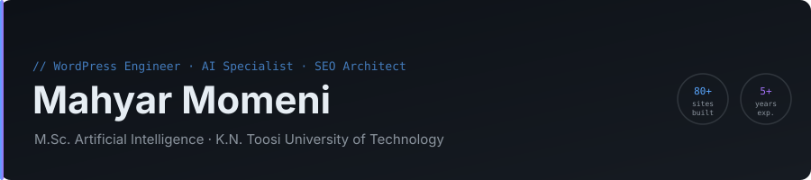
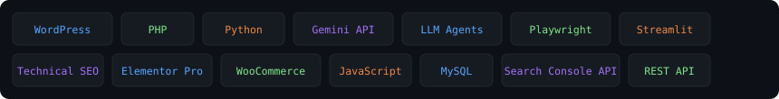

**[Website](https://mahyarhub.ir)** · **[LinkedIn](https://ir.linkedin.com/in/mahyar-momeni-4a46b2223)** · **[Telegram](https://t.me/mahyar_mmi)** · **[Email](mailto:mahyarmni@gmail.com)** · **[فارسی](README.fa.md)**

---

## About

WordPress engineer and AI specialist with 5+ years of production experience across plugin development, web design, and applied AI automation. Holds an **M.Sc. in Artificial Intelligence** from [K.N. Toosi University of Technology](https://kntu.ac.ir).

Work spans three areas:

- **Custom WordPress plugins** — production-grade, from SEO tooling to LLM-integrated agents
- **Web design & development** — 80+ client websites across legal, e-commerce, academic, and corporate sectors
- **AI automation & tooling** — Python agents, crawlers, SEO and lead-generation tools, LLM pipelines (Gemini, Groq, OpenRouter)

---

## WordPress Plugins

All plugins are written by **Mahyar Momeni**, ship with English + Persian documentation, and carry a risk level:
🟢 low · 🟡 medium (modifies data/files or uses third-party services) · 🔴 high (can harm sites or break rules if misused — read the risk notice first).

| Plugin | Version | Risk | Description |
|---|:---:|:-:|---|
| [**Backlink Pilot**](https://github.com/mahyarrmni/backlink-pilot) | 1.10.0 | 🔴 | Free. Backlink lifecycle: domain scoring, AI planning agent, autopilot publishing to 10+ platforms (Telegra.ph, DEV.to, Write.as, Hashnode…) with review mode and cautious/balanced/fast profiles, Search Console integration, and a weekly-learning radar. **Automated link building carries search-engine and platform risk — read the notice.** |
| [**SEO Intelligence**](https://github.com/mahyarrmni/seo-intelligence) | 2.2.0 | 🟢 | Reads real Google Search Console data and surfaces CTR gaps, ranking plateaus and keyword-clustering opportunities. Read-only — no fake clicks, no fake traffic. |
| [**Content Cannibalization Scanner**](https://github.com/mahyarrmni/content-cannibalization-scanner) | 2.2 | 🟡 | Detects keyword cannibalization and duplicate intent; v2.2 adds a site security report (malware signatures, plugin/theme CVEs via WPVulnerability, Safe Browsing, core integrity) with dry-run, backup and rollback. |
| [**404 Radar**](https://github.com/mahyarrmni/404-radar) | 1.1.0 | 🟢 | Logs 404s, suggests the closest page and fixes them with one-click 301 redirects; optional rules and weekly e-mail digest. Bilingual UI. |
| [**QA Contact Form**](https://github.com/mahyarrmni/qa-contact-form) | 2.1.0 | 🟢 | Contact form with drag-and-drop builder, Iranian validators (mobile / national ID / postal code), file upload, auto-reply, Telegram & webhook notifications, CSV export and multi-layer anti-spam. |
| [**Phone Number Changer**](https://github.com/mahyarrmni/phone-number-changer) | 1.1 | 🟡 | Replaces a phone number across a site in all common Iranian formats. Temporary (HTML-only) and permanent (database, with dry-run) modes. |
| [**Smart Alt Setter**](https://github.com/mahyarrmni/smart-alt-setter) | 1.1.0 | 🟡 | Bulk-assigns ALT text (in order) only to images used in published posts and pages. |
| [**Bulk Image Alt**](https://github.com/mahyarrmni/bulk-image-alt) | 1.3.0 | 🟡 | Sets ALT text (in order) for media-library images that have none, with an audit report and a guarded delete-all action. |
| [**AI Comment Seeder Pro**](https://github.com/mahyarrmni/ai-comment-seeder) | 5.2.0 | 🔴 | Gemini-powered comment generation with scheduling and a WP-Cron queue (comments held for moderation by default). **Synthetic comments can be deceptive and violate spam/consumer-protection rules — intended for staging/demo or human-reviewed drafts.** |

---

## Python Tools — [python-toolkit](https://github.com/mahyarrmni/python-toolkit)

One repository, every tool documented in English + Persian with install, step-by-step usage, troubleshooting and a risk level.

| Group | Tool | Risk | What it does |
|---|---|:-:|---|
| SEO | **SEO Analyzer** | 🟢 | On-page analysis of one URL (or two side by side): meta, headings, images, links, content, technical files, 0–100 score. Streamlit, unit-tested. |
| SEO | **SEO Audit Bot** | 🟢 | Crawls a whole site, scores every page, finds broken links; HTML + CSV report. |
| SEO | **Keyword Miner** | 🟡 | Seed word → hundreds of autocomplete keyword ideas with intent tags and clusters; interactive report. |
| Leads | **Maps Leads Bot** | 🟡 | Business lists by category and city through the official Google Places API (New) → CSV. |
| Leads | **B2B Lead Intelligence** | 🟡 | Async crawler that extracts public contacts, socials and technologies from domains, scores leads A–D, SQLite + HTML dashboard. Obeys robots.txt by default. |
| Security | **AI Web Vulnerability Scanner** · **DeepScanner** | 🔴 | ML-assisted scanner and extended JS/port analysis. **Authorised targets only.** |
| AI | **Crypto Analyzer** | 🟢 | 90-day chart, SMA/EMA/RSI/Momentum and a trend line — not financial advice. |
| AI | **Decor AI** (image redesign · chat · local LLM) | 🟡 | Flet desktop apps for interior-design ideas (Replicate API / DuckDuckGo / local GPT-2 fa). |
| Utilities | **Image Optimizer** | 🟢 | Convert, resize, compress and watermark up to 20 images; ZIP download. |
| Utilities | **Auto Image Downloader** | 🟡 | Downloads Unsplash images per keyword (respect photo licenses). |
| Utilities | **FileSage** | 🟢 | Organises folders by type/date, finds duplicates and similar images, HTML report, full undo; dry-run by default, never deletes. |

---

## Web Design Portfolio — Selected Work

The complete categorised list (80+ sites) is in **[WEBSITES.md](WEBSITES.md)**.

### Platforms & Own Products

| Site | Notes |
|---|---|
| [fa-tools.ir](https://fa-tools.ir) | Persian developer-tools library — custom plugins, homepage, and full technical SEO architecture. |
| [mahyarhub.ir](https://mahyarhub.ir) | Personal hub and plugin distribution platform. |
| [toopgame.ir](https://toopgame.ir) | Gaming gear e-commerce — custom homepage, filtering system, and category SEO. |

### E-commerce

| Site | Notes |
|---|---|
| [electroabzar.com](https://electroabzar.com) | Electronics tools store — product catalogue, UX components, on-page SEO. |
| [bavandecor.ir](https://bavandecor.ir) | Home-decor online store — custom homepage and product architecture. |
| [modipod.ir](https://modipod.ir) | Specialty retail — custom homepage, header/footer, product pages. |
| [jpod.ir](https://jpod.ir) | Online store with custom interface and SEO structure. |
| [eriscactus.ir](https://eriscactus.ir) | Cactus and succulent store with custom product catalogue. |
| [bazarenahal.ir](https://bazarenahal.ir) | Agricultural marketplace — custom components and SEO. |

### Legal Services

| Site | Notes |
|---|---|
| [talagh-vakil.ir](https://talagh-vakil.ir) | Divorce-law institute — custom homepage targeting high-volume search terms. |
| [tehran-atorney.com](https://tehran-atorney.com) | Full law-practice site: practice areas, profiles, consultation flow, SEO content. |
| [vokalaye-divan.com](https://vokalaye-divan.com) | Law practice — practice areas, SEO-structured content. |
| [onlinelawyer.ir](https://onlinelawyer.ir) | Online legal consultation platform. |
| [best-lawyer.ir](https://best-lawyer.ir) | Law-firm site with SEO-oriented service architecture. |
| [solhtalab.com](https://solhtalab.com) | Mediation and dispute-resolution services. |

### Academic & Research

| Site | Notes |
|---|---|
| [berneta.ir](https://berneta.ir) | Thesis consultancy — custom theme, homepage, and service structure. |
| [do-thesis.com](https://do-thesis.com) | Academic project and thesis support services. |
| [research-professor.com](https://research-professor.com) | Research support and academic consultancy. |
| [qarticleproject.ir](https://qarticleproject.ir) | Academic project services with enquiry flow. |
| [samarehlab.com](https://samarehlab.com) | Lab services and academic support platform. |

### Corporate & B2B

| Site | Notes |
|---|---|
| [novinanbar.ir](https://novinanbar.ir) | Warehouse & logistics consultancy — custom homepage, E-E-A-T content. |
| [behsangit.ir](https://behsangit.ir) | Corporate profile and services presentation. |
| [pouyeshgroup.com](https://pouyeshgroup.com) | Group corporate site with service architecture. |
| [farimehrgroup.ir](https://farimehrgroup.ir) | Corporate profile, services, and contact channels. |

### Media & Education

| Site | Notes |
|---|---|
| [mr-gamer.ir](https://mr-gamer.ir) | Gaming news/reviews — custom homepage, blog filter, category templates. |
| [learnelement.ir](https://learnelement.ir) | Educational resource for Elementor and WordPress. |
| [javab-quiz.ir](https://javab-quiz.ir) | Quiz and structured Q&A platform. |
| [actorpic.ir](https://actorpic.ir) | Actor and entertainment content site. |

---

## Technical Stack

---

## Responsible use & disclaimer

My tools are built for **your own sites, systems and data**, or ones you are explicitly authorised to work with. Everything is provided **"as is", without warranty**.
**You alone are responsible for how you use it** — including the laws of your country, the terms of every third-party platform, and privacy/anti-spam rules.
I (Mahyar Momeni) and contributors accept no liability for damage, penalties, bans, de-indexing, legal claims or fines resulting from use or misuse.
Tools that automate link building, generate synthetic comments, scan for vulnerabilities or handle contact data carry the 🔴/🟡 risk levels above and a notice in their README.
I do not publish or support tools for fake traffic/click manipulation or comment spam.

---

## Services

- Custom WordPress plugin development (PHP 8, OOP, REST API, WP-Cron)
- Website design and development (Elementor Pro, WooCommerce, custom themes/templates)
- Technical SEO and content architecture
- AI integration and workflow automation (LLM pipelines, agents, Python bots)

---

**[mahyarhub.ir](https://mahyarhub.ir)** · **[Telegram](https://t.me/mahyar_mmi)** · **[mahyarmni@gmail.com](mailto:mahyarmni@gmail.com)**

