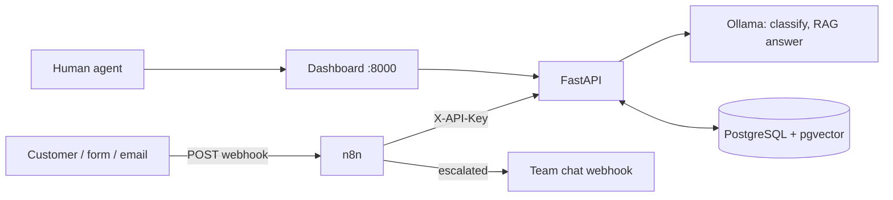

# SupportFlow AI

📖 **[راهنمای کامل فارسی (README.fa.md)](README.fa.md)**

Self-hosted AI customer-support automation. **No paid APIs, no cloud, no telemetry.**
Stack: n8n · FastAPI · Ollama · PostgreSQL + pgvector · Docker. Works for any business; Persian (fa) by default, English supported.

## Features
- Ticket **classification**, **sentiment analysis** and rule-based **prioritisation** (low → urgent)
- **RAG** answers grounded in your own knowledge base (multilingual `bge-m3` embeddings)
- Automatic reply or **human escalation** (sensitive topics, urgent, angry customer, human requested, no KB match, low confidence, AI failure → always a human)
- Dark-gradient RTL **dashboard**: escalation queue, replies, ticket list, knowledge base, test console
- Exportable **n8n workflows**: ticket intake (webhook → API → alert → reply) and SLA reminder
- API-key auth, rate limiting, strict validation, prompt-injection hardening, non-root container, localhost-only ports



## Quick start
Requirements: Docker Compose v2, ~8 GB RAM free (GPU optional), openssl.
```bash
git clone <your-repo-url> supportflow-ai && cd supportflow-ai
sh scripts/init-env.sh              # generates .env with random secrets
docker compose up -d --build
docker compose logs -f model-init   # wait until models are pulled (first run only, ~5 GB)
sh scripts/seed.sh                  # optional demo knowledge base
```
- Dashboard: http://localhost:8000 (enter `API_KEY` from `.env`)
- n8n: http://localhost:5678 → create the owner account, then import workflows:
  ```bash
  docker compose exec n8n n8n import:workflow --separate --input=/workflows
  ```
  Open each workflow and **activate** it.
- Submit a ticket through n8n:
  ```bash
  curl -X POST http://localhost:5678/webhook/support-ticket \
    -H "x-webhook-secret: $(grep ^WEBHOOK_SECRET .env | cut -d= -f2)" -H "Content-Type: application/json" \
    -d '{"subject":"بازگشت وجه","body":"چطور می‌تونم پولم رو پس بگیرم؟"}'
  ```
  (Use the *test URL* `/webhook-test/support-ticket` while the workflow is not active.)

## API (`X-API-Key` header required under `/api`)
| Method | Path | Purpose |
|---|---|---|
| POST | `/api/tickets` | Run the AI pipeline, store ticket, return `customer_reply` |
| GET | `/api/tickets?status=&limit=&offset=` | List (escalated queue sorted by priority) |
| GET | `/api/tickets/{id}` | Ticket detail |
| POST | `/api/tickets/{id}/resolve` | Human reply, closes ticket |
| GET | `/api/stats` | Counters by status/category/priority |
| GET / POST / DELETE | `/api/kb`, `/api/kb/{id}` | Manage knowledge base |
| GET | `/health`, `/ready` | Liveness / readiness (DB + Ollama) |

Interactive docs at `/docs` when `APP_ENV=development`.

## Configuration (`.env`)
| Variable | Default | Notes |
|---|---|---|
| `CHAT_MODEL` | `qwen2.5:7b` | Good Persian. Use `qwen2.5:3b` on weak hardware, any Ollama model works |
| `EMBED_MODEL` | `bge-m3` | Multilingual, 1024 dims. Changing dims requires editing `db/init.sql` |
| `RAG_MIN_SIMILARITY` | `0.5` | Below this → "no KB match" → human |
| `ESCALATION_CONFIDENCE` | `0.6` | Below this → human (AI draft is kept for the agent) |
| `ESCALATION_WEBHOOK_URL` | empty | Slack/Mattermost-compatible incoming webhook for alerts |
| `APP_ENV` | `production` | Production refuses weak `API_KEY` and hides `/docs` |

## Security notes
- Secrets only in `.env` (git-ignored, `chmod 600`). Compose fails fast if they are missing.
- Services bind to `127.0.0.1`; put a TLS reverse proxy (Caddy/Traefik/nginx) in front for remote access and set `N8N_SECURE_COOKIE=true`.
- Ticket/KB text is treated as untrusted data in prompts; AI output is validated and clamped; sensitive categories are never auto-answered.
- Rate limiter is per process (single API replica). LLM output can be wrong: keep human review for important cases.

## Development
```bash
cd backend && python -m venv .venv && . .venv/bin/activate
pip install -r requirements-dev.txt && pytest -q
```
CI (GitHub Actions) runs tests and validates workflow JSON. See [docs/architecture.md](docs/architecture.md).

## خلاصه فارسی
سامانهٔ پشتیبانی هوشمند کاملاً خودمیزبان: طبقه‌بندی تیکت، تحلیل احساس، اولویت‌بندی، پاسخ خودکار مبتنی بر پایگاه دانش (RAG) و ارجاع به کارشناس انسانی. با `sh scripts/init-env.sh` و `docker compose up -d --build` راه‌اندازی می‌شود و داشبورد در `http://localhost:8000` در دسترس است. سیاست امنیتی: موضوعات حقوقی/امنیتی، مشتری بسیار ناراضی، درخواست اپراتور، یا نبود پاسخ مطمئن همیشه به انسان ارجاع می‌شود.

## License
MIT
